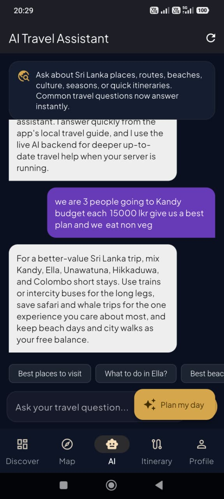
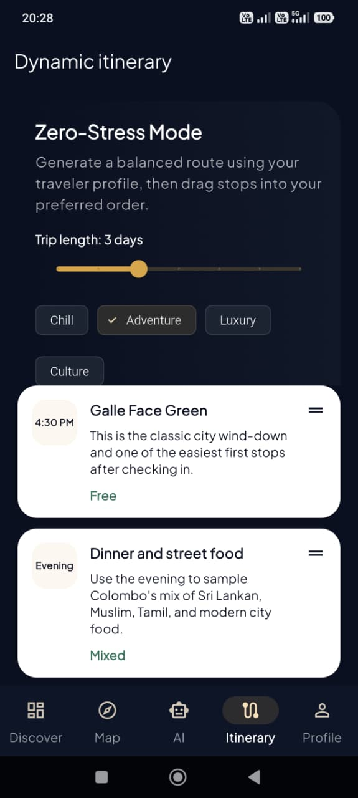

# SD Travel Guide

A Flutter application focused on helping visitors explore Sri Lanka through destination discovery, maps, travel phrases, voice interaction and trip-planning interfaces.

> **Project status:** Academic/personal project in active development. This README separates code-backed functionality from optional services and future ideas so that the project is easy to assess accurately.

## Screenshots

| Home | AI assistant interface |
|---|---|
|  |  |

| Splash | Travel wallet |
|---|---|
|  |  |

## Implemented components

- Flutter and Dart mobile application structure.
- Sri Lanka destination and place content.
- Map interface using `flutter_map` and `latlong2`.
- Device location support through `geolocator`.
- Voice input and text-to-speech packages.
- Local SQLite storage foundation.
- A phrase-based English/Sinhala/Tamil travel translator for a curated set of common phrases.
- Nearby-place filtering using geographic distance calculations.
- Travel assistant interface with an optional Python backend endpoint for OpenAI-powered responses when a backend API key is configured.

## Technology

- **Mobile:** Flutter, Dart
- **Maps & location:** `flutter_map`, `latlong2`, `geolocator`
- **Voice:** `speech_to_text`, `flutter_tts`
- **Local storage:** `sqflite`
- **Networking:** `http`
- **Optional assistant backend:** Python standard library HTTP server and OpenAI Responses API

## Project structure

```text
lib/        Flutter application source
assets/     Branding, place media and offline map assets
backend/    Optional translation and AI chat backend
docs/       Architecture notes, API notes and screenshots
test/       Flutter widget tests
tool/       Project helper scripts
```

## Run the Flutter app

Install the Flutter SDK, then run:

```bash
flutter pub get
flutter analyze
flutter test
flutter run
```

## Optional Python backend

The backend exposes a health endpoint, a phrase-translation endpoint and an optional AI chat endpoint.

```bash
python backend/translation_server.py
```

For AI chat, configure the key on the backend machine only:

```bash
export OPENAI_API_KEY="your_api_key"
export OPENAI_MODEL="gpt-5-mini"
python backend/translation_server.py
```

On Windows PowerShell:

```powershell
$env:OPENAI_API_KEY="your_api_key"
$env:OPENAI_MODEL="gpt-5-mini"
python backend\translation_server.py
```

Never commit API keys or place private keys in Flutter/mobile code. The phrase translator has a limited curated vocabulary; it is not a general-purpose machine translation model.

## Current limitations and next steps

- Expand and validate the travel phrase dataset with native-speaker review.
- Add automated tests for translation matching and nearby-place distance calculations.
- Document the actual backend deployment and environment configuration before describing it as production-ready.
- Add a verified app demonstration or release build when available.
- Keep future ideas (such as advanced itinerary intelligence and production authentication) clearly labelled until implemented and tested.

## Learning and contribution notes

This repository is intended to demonstrate application development, integration of mobile capabilities and iterative project work. Screenshots show the current interface; optional backend functionality depends on local configuration and credentials.
