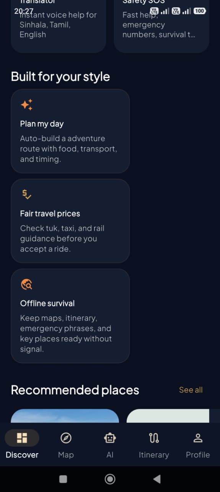

# SD Travel Guide

Sri Lanka travel super app built with Flutter.

SD Travel Guide combines AI travel help, dynamic itinerary planning, translation, tourist maps, place discovery, safety tools, and budget tracking into one mobile experience for travelers visiting Sri Lanka.

## Screenshots

| Splash | Discover |
|---|---|
|  |  |

| AI Assistant | Travel Wallet |
|---|---|
|  |  |

## Highlights

- Sri Lanka-focused AI travel assistant
- Dynamic itinerary builder with editable destinations
- Online/offline map experience
- Sinhala, Tamil, and English travel translation
- Detailed tourist places explorer
- Safety help and offline survival tools
- Travel wallet and budget tracking
- Auth, OTP, profile, and admin/backend foundation

## Features

### 1. AI Travel Assistant
- Answers local travel questions with Sri Lanka-aware guidance
- Supports practical prompts like destination + budget + group size + food preference
- Uses local guide data first and can extend to a live backend

### 2. Dynamic Itinerary Builder
- Builds day plans from traveler mood and profile
- Lets users swap destinations, for example `Colombo -> Nuwara Eliya`
- Includes route hints, food guidance, and budget feel

### 3. Smart Map
- Tourist destination markers
- Online/offline switching
- Search and route-focused travel UI

### 4. Translator
- Travel-oriented Sinhala, Tamil, and English translation
- Voice workflow support for tourism use cases

### 5. Places Explorer
- Curated Sri Lanka destination catalog
- Detailed place guidance, gallery support, and visit-plan style content

### 6. Safety and Offline Support
- Offline survival guide
- Emergency phrase pack
- Fair travel price guidance

### 7. Travel Wallet
- Daily budget overview
- Category-based expense breakdown
- Quick-add spend actions

## Tech Stack

- **Frontend:** Flutter, Dart
- **Maps:** `flutter_map`, `latlong2`
- **Location:** `geolocator`
- **Voice:** `speech_to_text`, `flutter_tts`
- **Local storage:** SQLite via `sqflite`
- **Networking:** `http`
- **Backend foundation:** Node.js admin/platform starter + local AI/translation backend

## Project Structure

```text
lib/        Flutter app source
assets/     Branding, place media, offline map assets
backend/    Translation backend + admin/platform backend starter
docs/       Architecture notes, API contracts, GitHub docs, screenshots
tool/       Local helper scripts
```

## Run Locally

```bash
flutter pub get
flutter run
```

### Optional backend helpers

- `backend/translation_server.py` for local AI/translation support
- `backend/platform/` for auth/admin/dashboard foundation

## Product Direction

SD Travel Guide is being developed toward a tourism super app with:

- smarter Sri Lanka travel planning
- stronger offline survival support
- tourist-safe transport guidance
- richer destination intelligence
- better AI-assisted decision support

## Repository Notes

- This repository currently includes large local media assets for destination galleries.
- A later optimization pass can shrink image sizes and reduce repository weight further without changing the app concept.

## CV-Friendly Summary

**SD Travel Guide**  
Flutter-based Sri Lanka tourism app featuring AI travel assistance, dynamic itinerary planning, translation, smart maps, safety tools, and budget tracking.
